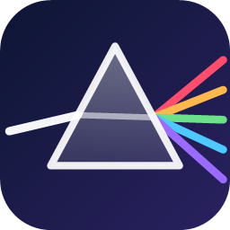
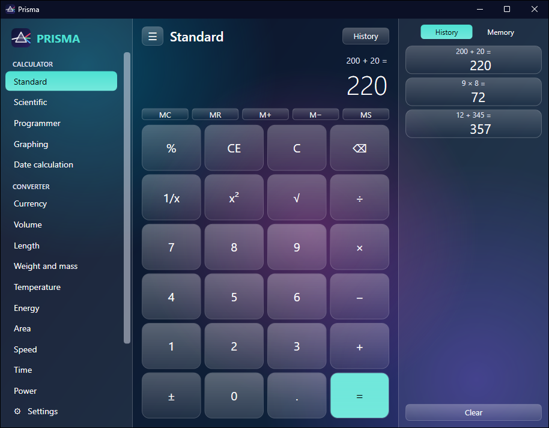
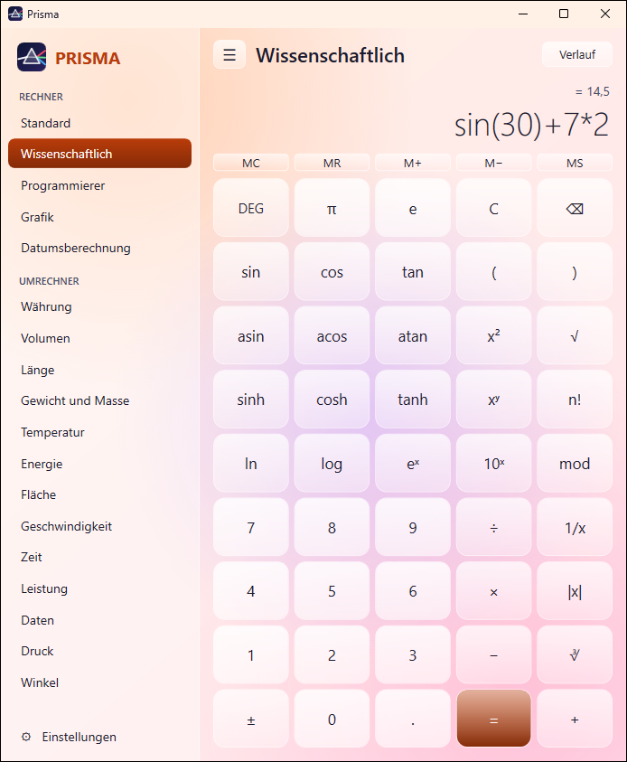
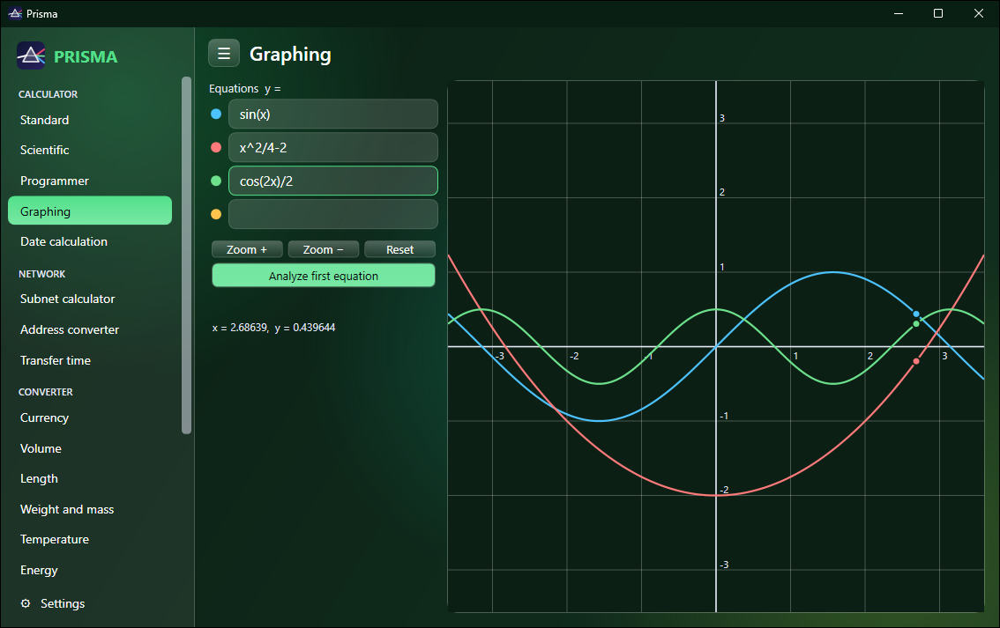
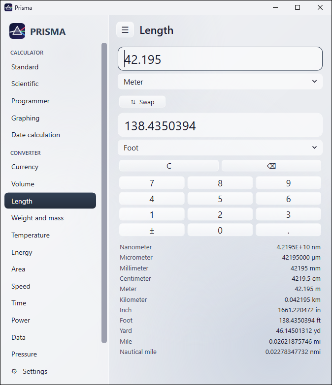
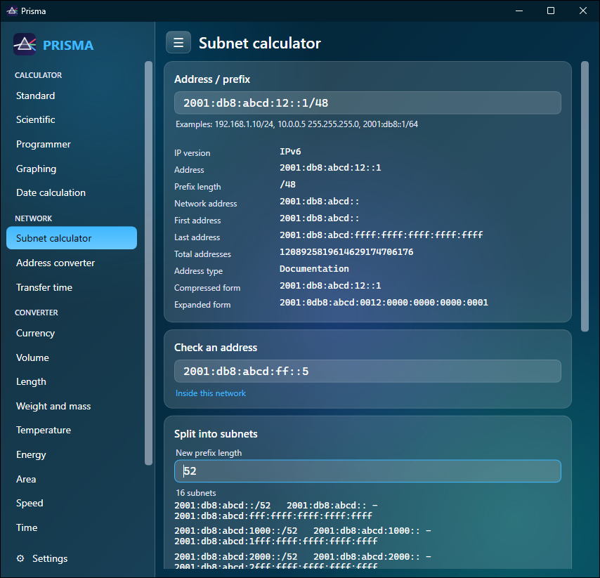
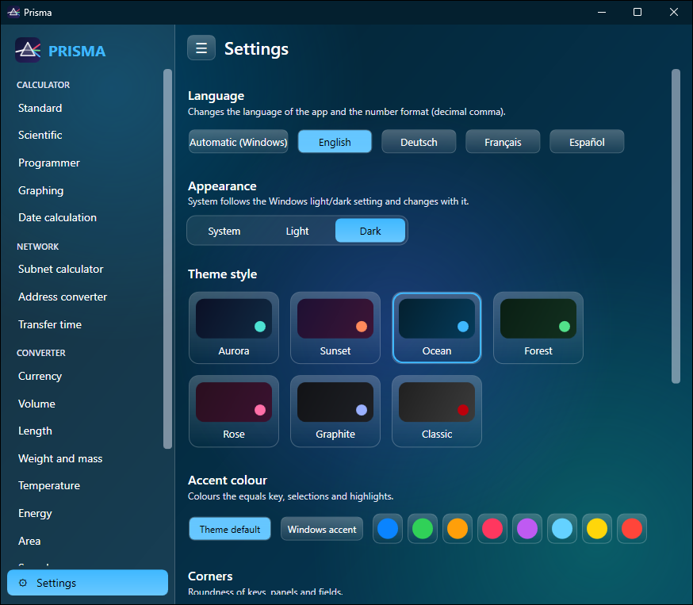

# Prisma



A calculator for Windows with a liquid-glass look, written in C# 5 and WPF. Standard, scientific, programmer and graphing modes, date calculation, unit converters and network tools (IPv4/IPv6 subnets). No installer, no dependencies, no network access.

[](https://github.com/30jannik06/Prisma-Calc/actions/workflows/ci.yml)

## Screenshots
| Standard (Aurora, dark) | Scientific (Sunset, light) |
|---|---|
|  |  |

| Graphing (Forest, dark) | Unit converter (Graphite, light) |
|---|---|
|  |  |

| Subnet calculator with IPv6 (Ocean, dark) | Settings (Ocean, dark) |
|---|---|
|  |  |

## Download
Get `Prisma.zip` from the **Releases** page, unzip it and start `Prisma.exe`. It needs Windows 10 (1607 or newer) or Windows 11; .NET Framework 4.6.2+ is already part of them.

Windows SmartScreen may warn on first start because the program is not code-signed. Check your download first: the release description lists the SHA-256 hash of `Prisma.zip`.
```powershell
(Get-FileHash .\Prisma.zip -Algorithm SHA256).Hash
```
Releases of public repositories also carry a build provenance attestation (`gh attestation verify Prisma.zip --repo 30jannik06/Prisma-Calc`).

## Features
**Calculator modes**
- **Standard** - + - x /, %, 1/x, x^2, sqrt, negate, backspace, memory (MC MR M+ M- MS), history, keyboard input, copy/paste.
- **Scientific** - expression entry with parentheses and operator precedence, sin/cos/tan and inverses, hyperbolic functions, ln, log, e^x, 10^x, x^y, n!, mod, |x|, cube root, pi, e, DEG/RAD/GRAD, live result preview, memory and history.
- **Programmer** - HEX / DEC / OCT / BIN shown at the same time, QWORD / DWORD / WORD / BYTE word sizes, AND OR XOR NOT NAND NOR, shifts, rotate, signed wrap-around.
- **Graphing** - up to four equations y = f(x), pan (drag), zoom (wheel or buttons), hover trace, zeros and extrema of the first equation.
- **Date calculation** - difference between two dates (years, months, days, total days) and add/subtract years, months, days.

**Network tools** (pure calculations; Prisma never contacts the network)
- **Subnet calculator (IPv4 and IPv6)** - type `192.168.1.10/24`, `10.0.0.5 255.255.255.0` or `2001:db8::1/64`: network, broadcast, first/last host, mask, wildcard, address and host counts (exact, also for IPv6's huge numbers), address type (private, loopback, link-local, multicast, documentation, ...), class, binary form, short and long IPv6 forms. Also: *is this address inside the network?*, *split into subnets*, and *how big a subnet do I need for N hosts?*.
- **Address converter** - dotted IPv4, decimal number, hexadecimal, binary, IPv4-mapped IPv6, IPv6 short/long form, reverse-DNS name. Accepts `192.168.1.1`, `3232235777`, `0xC0A80101`, `0b1100...`, `2001:db8::1`.
- **Transfer time** - file size, line speed and time: solve for any one of them, with the usable share of the line in percent. Times can be typed as `90`, `1:30:00` or `2h 15m`.
Click any result row to copy its value.

**Converters** - Currency, Volume, Length, Weight and mass, Temperature, Energy, Area, Speed, Time, Power, Data, Pressure, Angle. Every converter also lists the value in all units of its category.
Currency uses **example rates, not live rates** (no network access). Put your own rates in `%LOCALAPPDATA%\Prisma\rates.ini`, one `CODE=rate per 1 EUR` per line.

**Languages** - English, Deutsch, Français, Español, or automatic (follows Windows). Chosen in Settings and applied at once, no restart. Covers all labels, messages, unit names, weekday names and the number format (decimal comma in de/fr/es; typing a dot or a comma both work). Command line: `--language System|en|de|fr|es`.

**Theming and the liquid look** (all in the Settings page, bottom of the left bar)
- **Appearance:** System (follows Windows light/dark live), Light or Dark. High Contrast follows the system colours and always wins.
- **Theme style:** Aurora, Sunset, Ocean, Forest, Rose, Graphite (glass styles, each with a light and a dark variant) and Classic (flat).
- **Accent colour:** theme default, Windows accent, or one of eight presets. Colours the equals key, selections and highlights.
- **Corners:** Square, Soft (default) or Round. The radius follows the height of each element, so tall keys get moderate corners and short buttons never turn into pills.
- **Liquid glass surfaces:** translucent panels and keys with a light edge and sheen, gradient backdrop, springy key press.
- **Animated background:** colour blobs drift slowly behind the glass. Can be turned off to save power.
- The window keeps the size you give it when you change category (it only grows when a mode needs more room, e.g. Graphing) and remembers it for the next start.
- Smooth colour fade when anything changes, title bar in the theme colour (Windows 11), themed drop-downs and scroll bars, graph colours chosen per theme.
- Every style, variant, glass on/off and several accent colours are checked for readable contrast by the self-tests.

## Logo and icon
The logo is a prism that splits a white beam into five colours, drawn from scratch for Prisma (not taken from any other app). It is the program icon (16 to 256 px, embedded in `Prisma.exe`), the window and taskbar icon, the mark in the sidebar and the picture on the About card in Settings. The file properties (product, version 1.1.2, company, licence) are set too.
- `assets\prisma.ico` - icon with 7 sizes (small sizes use thicker lines and three beams so they stay readable)
- `assets\prisma-logo.svg` - vector logo; `assets\prisma-256.png` - preview
- `tools\make-icon.ps1` regenerates all three (Windows PowerShell only, no extra tools). The same geometry is in `src\Ui.cs` (`Ui.Logo`); keep them in sync when changing the design.

## Security
Prisma has no network access, starts no processes and runs as the normal user. It limits and validates all input (expressions, pasted text, `settings.ini`, `rates.ini`, command-line paths), restricts DLL loading to the Windows system folder and is built with ASLR, DEP and warnings-as-errors. Details, the threat model and known limits are in `SECURITY.md`. If your antivirus flags `Prisma.exe` it is a false positive (the file is unsigned and new, so it has no reputation yet); see the note in `SECURITY.md`. `verify.ps1` checks the files against `SHA256SUMS.txt`.

## Build
Needs only Windows' built-in `csc.exe` (.NET Framework 4.x developer files in `C:\Windows\Microsoft.NET\Framework64\v4.0.30319`). No downloads, no third-party dependency.
```
powershell -ExecutionPolicy Bypass -File build.ps1     # compiles src\*.cs to dist\Prisma.exe
powershell -ExecutionPolicy Bypass -File test.ps1      # builds the test program and runs 379 self-tests (no window shown, no network)
powershell -ExecutionPolicy Bypass -File package.ps1   # dist\ + SHA256SUMS.txt + Prisma.zip (local only)
powershell -ExecutionPolicy Bypass -File verify.ps1    # checks dist\ against SHA256SUMS.txt
```
The tests are **not** part of `Prisma.exe`: `test.ps1` compiles `tests\*.cs` into a separate `Prisma.Tests.exe` (in `build\`, never shipped) that loads the real `dist\Prisma.exe` as a library. The released program therefore contains no test code and none of the strings the security tests search for (names of download or networking APIs), which also keeps antivirus scanners from misreading it. `build.ps1` sets `DOTNET_CLI_TELEMETRY_OPTOUT=1` and moves `TEMP`/`TMP` to `.\.tmp`. `fetch-deps.ps1` only checks the toolchain.

## Run
```
dist\Prisma.exe [--theme Default|Light|Dark] [--mode <name>] [--language System|en|de|fr|es] [--settings <file>] [--log <file>]
dist\Prisma.exe --print-theme      # prints theme mode / OS setting / effective theme, no window
```
Modes: Standard Scientific Programmer Graphing Date Currency Volume Length Weight Temperature Energy Area Speed Time Power Data Pressure Angle Settings.
Exit codes: 0 ok, 1 failure (or a failed self-test), 2 usage error. Runtime: .NET Framework 4.6.2 or newer (part of Windows 10 1607+ and Windows 11).
Keyboard: digits and operators, Enter = equals, Esc = clear, Backspace, Delete = clear entry, Ctrl+C / Ctrl+V.

## Files the program writes
- Log: `%LOCALAPPDATA%\Prisma\prisma.log` (override with `--log`)
- Settings: `%LOCALAPPDATA%\Prisma\settings.ini` (`Theme=`, `Style=`, `Accent=`, `Glass=`, `Animate=`, `Corners=`, `Language=`, `WindowWidth=`, `WindowHeight=`, `Mode=`; override with `--settings`)
- Optional input: `%LOCALAPPDATA%\Prisma\rates.ini` (your own currency rates)

## Licenses
| Part | License |
|---|---|
| This program (all source in `src\`) | MIT, see `LICENSE` |
| .NET Framework / WPF (linked at run time, part of Windows) | Microsoft, shipped with Windows, not redistributed here |
| Third-party code | none |

## Contributing and project files
- [CONTRIBUTING.md](CONTRIBUTING.md) - build, test, rules, translations, releases
- [CHANGELOG.md](CHANGELOG.md) - what changed in each version
- [SECURITY.md](SECURITY.md) - threat model, protections, how to report a vulnerability
- [docs/DESIGN-NOTES.md](docs/DESIGN-NOTES.md) - design decisions and why
- GitHub Actions: `ci.yml` builds and tests every push and pull request; `release.yml` publishes a release when a `vX.Y.Z` tag is pushed.

## Not included
Live currency rates, always-on-top compact overlay, graph export/share, equation analysis beyond zeros and extrema, right-to-left languages, real background blur (the glass is translucent colour over the animated gradient, not a blur of other windows).
